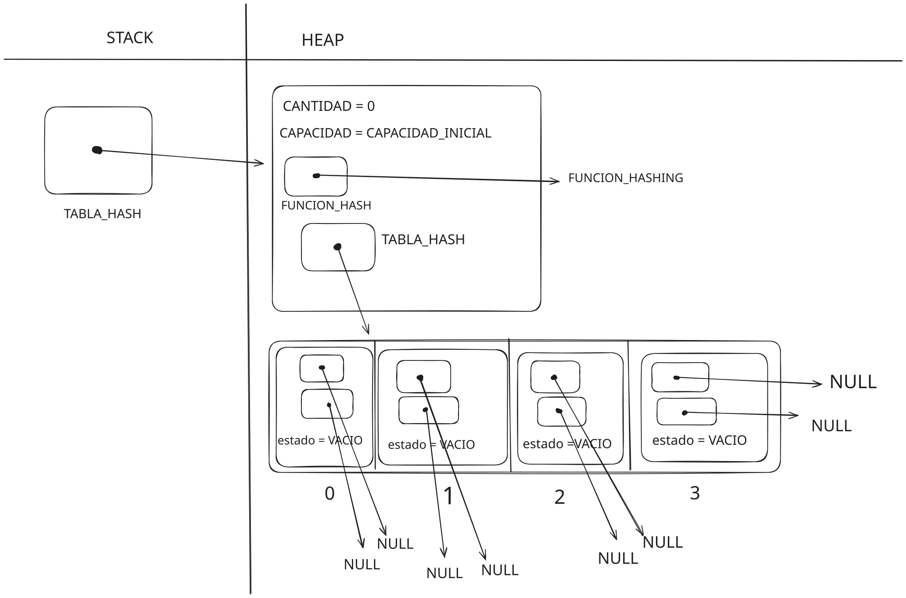
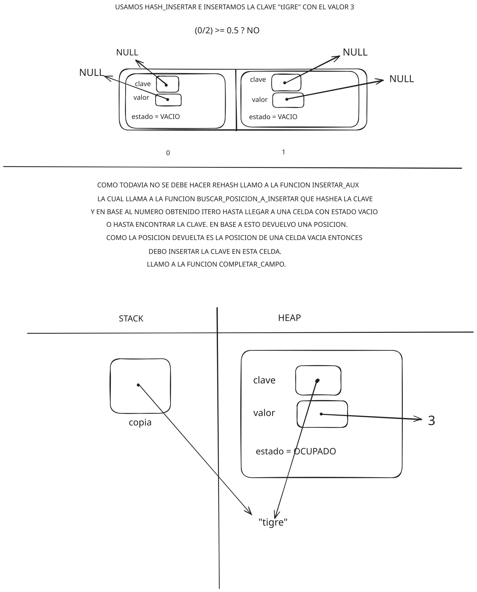
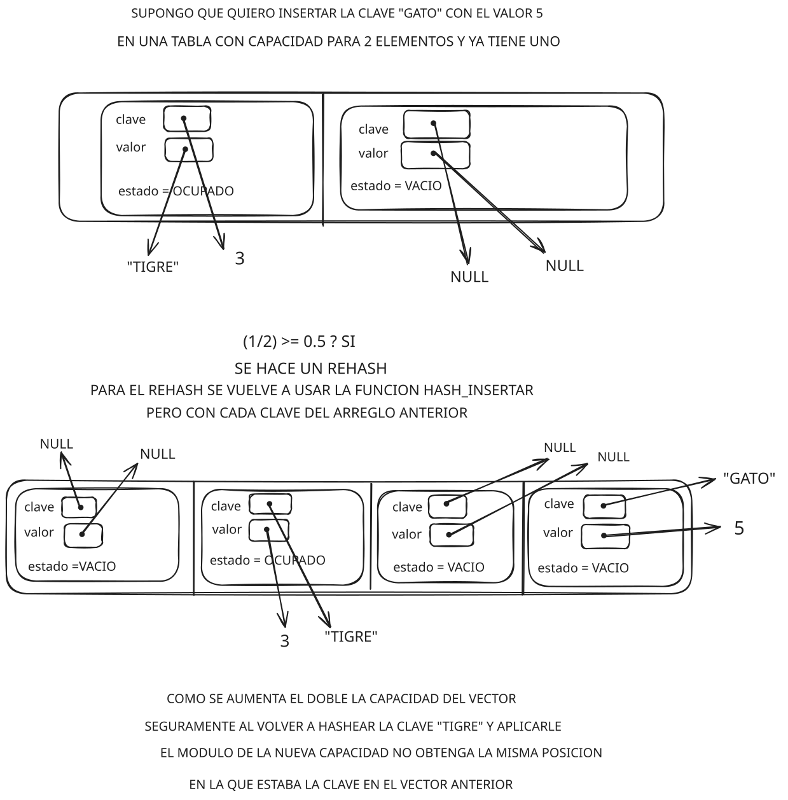
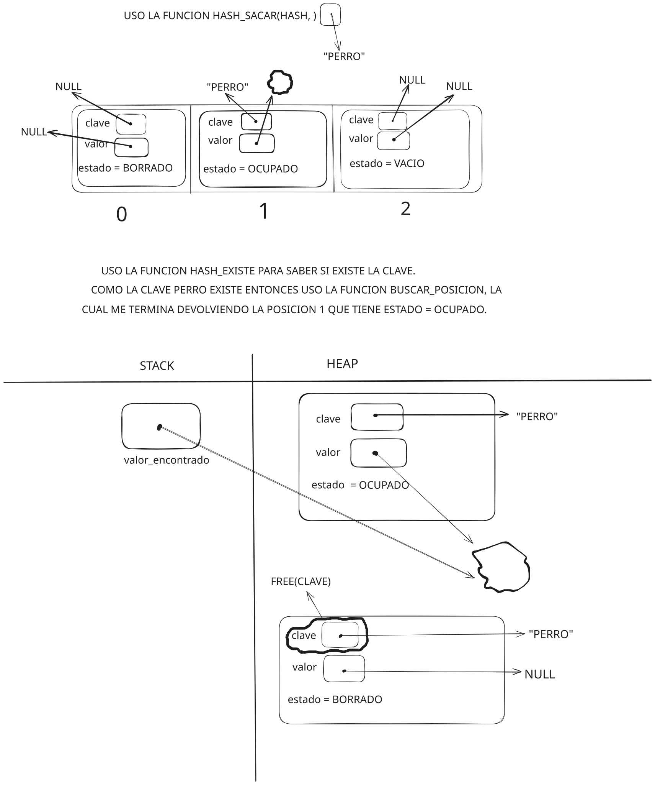
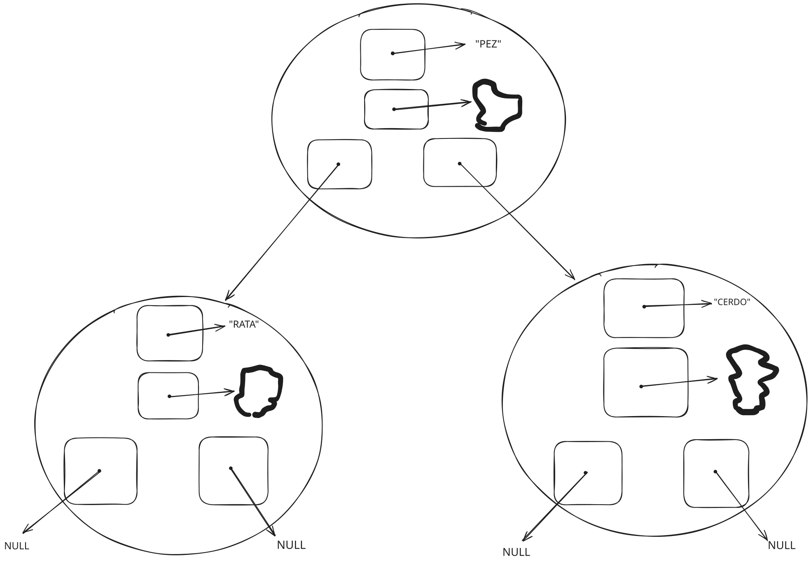
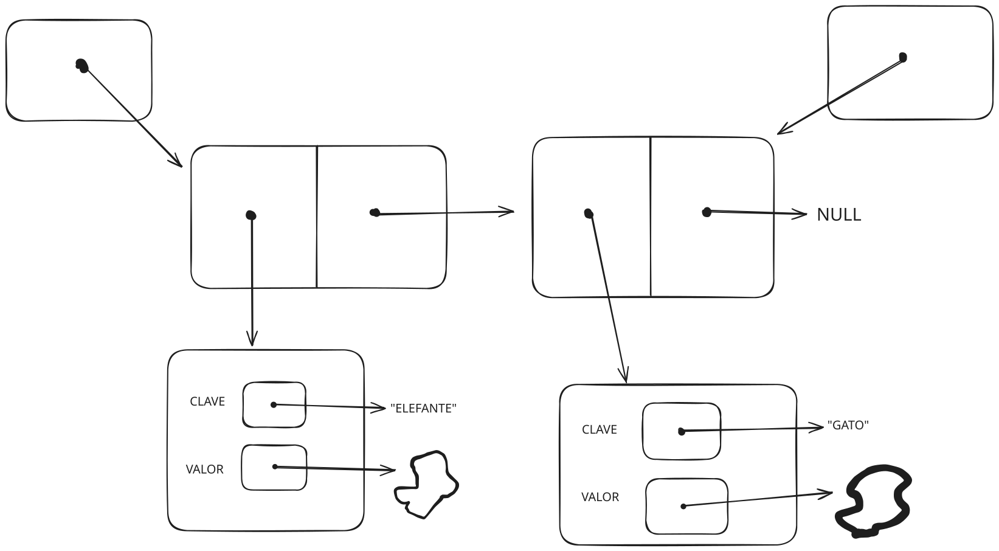
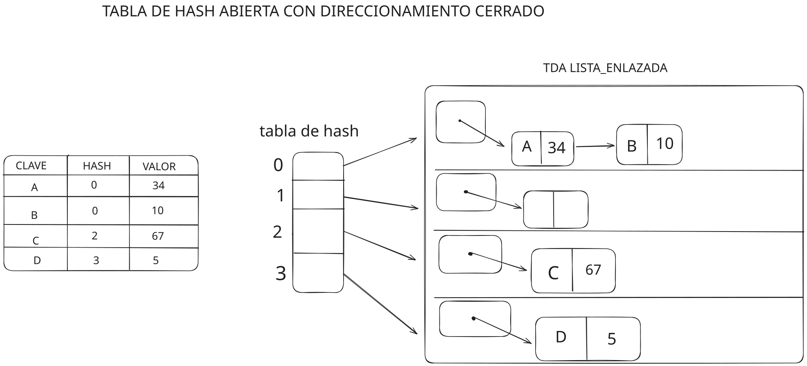
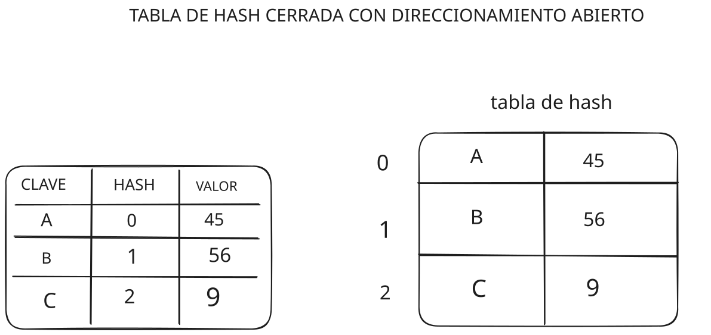
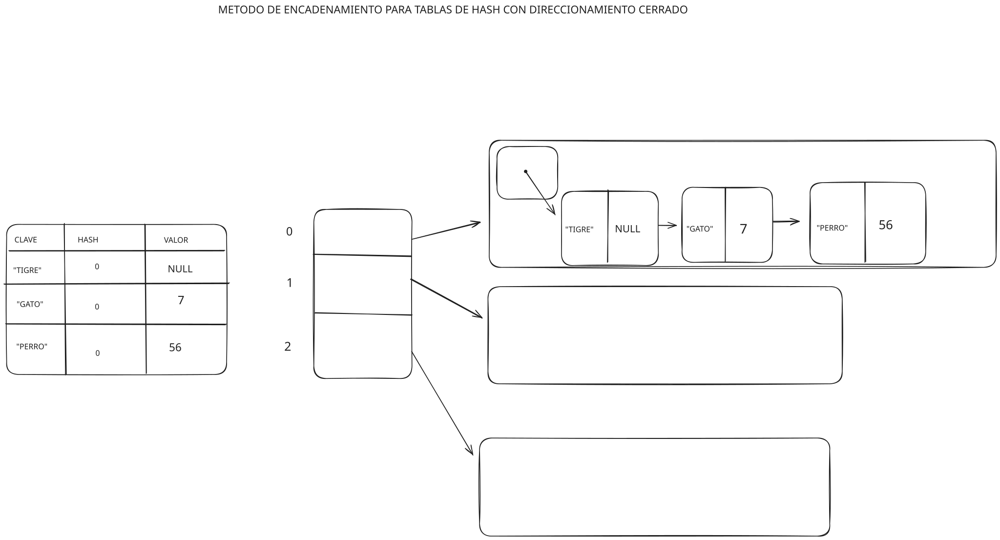
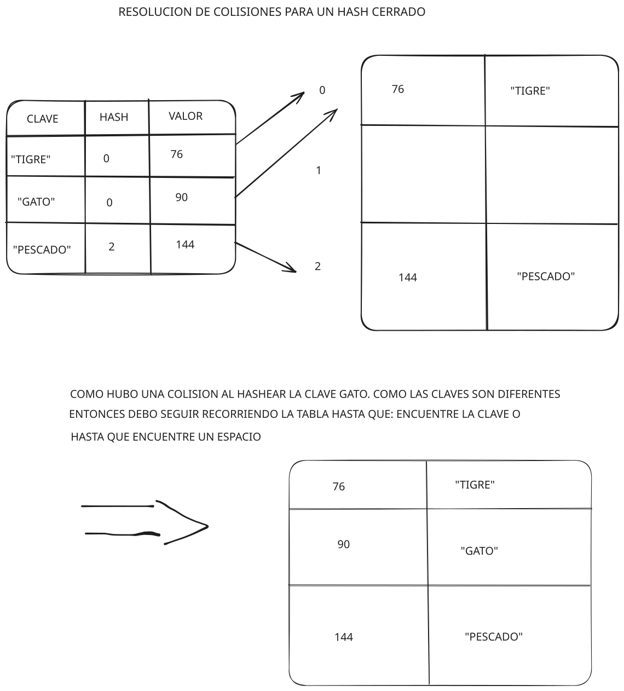

<div align="right">

</div>

# TDA HASH

## Repositorio de (Dylan Tiziano Robledo) - (112439) - (trobledo2017@gmail.com)

- Para compilar:

```bash
 gcc pruebas_alumno.c src/hash.c -Wall -Wextra -Wconversion -Werror -std=c99 -g -o pruebas_alumno
```

- Para ejecutar:

```bash
./pruebas_alumno
```

- Para ejecutar con valgrind:
```bash
valgrind --leak-check=full ./pruebas_alumno
```
---
##  Funcionamiento

El programa funciona reservando memoria para la estructura del hash y a partir de que el hash fue creado con cierta capacidad se pueden efectuar distintas operaciones con este mismo. Por ejemplo: se pueden insertar claves, las cuales son strings con valores de cualquier tipo de dato, se pueden eliminar claves, saber si existe una clave, buscar una clave y devolver su valor, consultar la cantidad de claves del hash, iterar sobre las claves y por último destruir el hash. Para crear el hash se utiliza principalmente la función de hash_crear_con_funcion ya que si se llama a hash_crear entonces la función de hasheo asignada es la que yo utilizo pero si el usuario que usa mi implementación tiene una mejor función de hash entonces debe usar la función de hash_crear_con_funcion y proporcionar una suya. Esto fue implementado de esta manera porque al momento de operar con el hash no se sabe a ciencia cierta si el hash fue creado con hash_crear o con hash_crear_con_funcion y por ende las funciones que operan sobre el hash no sabrían si usar mi función de hasheo o la que fue proporcionada por el usuario.

### Por ejemplo:

Este sería un ejemplo de como se vería la estructura del hash en memoria  

<div align="center">

</div>

## COMO FUNCIONA LA FUNCION DE HASH USADA:
Esta función de hash es una función de hash conocida como "djb2" y es muy útil para hashear strings. Básicamente lo que hace es definir una variable de tipo unsigned long en 5381 y declarar una variable c. Luego se hace un bucle que va a iterar mientras el caracter del string sea distinto del caracter nulo y va a asignar a la variable c el valor ascii del caracter. Luego dentro de este bucle ejecuta una operación a nivel de bits desplazando el numero 5 bits a la izquierda y a eso sumarle el mismo número. Luego a todo eso sumarle el valor ascii de la variable c. Para ser más claros, en realidad lo que se esta haciendo es multiplicar la variable hash por 33 y a eso sumarle el valor ascii de la letra. Este proceso lo hace hasta llegar al caracter nulo del string.

## EXPLICACION DE ALGUNAS FUNCIONES DEL TDA HASH

### COMO FUNCIONA HASH_INSERTAR:
En principio para esta función se revisa si el hash no es NULL o la clave es NULL. Luego si la cantidad de claves dividido la capacidad de la tabla es >= 0.5 entonces se hace un rehash. Para el rehash reservo memoria para un nuevo vector pero con el doble de la capacidad de la tabla antigua inicializando la nueva tabla y luego vuelvo a hashear cada clave de la tabla antigua para insertarlos en la nueva tabla. Para hacer esto vuelvo a reutilizar la función de hash_insertar en donde se llama a una función auxiliar llamada insertar_aux que se encarga de insertar/actualizar la clave en la tabla indicando con un puntero a una variable booleana si es que se pudo realizar la acción. Antes de hacer cualquier inserción o actualización dentro de esta función, llamo a una función llamada buscar_posicion_a_insertar que se encarga de buscar la posición correcta en donde debería ir esa clave. Si la posición corresponde a un casillero que ya se encuentra ocupado entonces es porque encontró la clave en el camino, sino la posición va a corresponder a un casillero que se encuntra vacío o el primer casillero con estado borrado que había encontrado. Esto es así porque si se hashea la clave lo que puede pasar es que debido a una colisión la clave se encuentre más adelante y por ende se debe seguir hasta encontrarla o hasta llegar a un espacio vacío.

<div align="center">

</div>

<div align="center">

</div>


### COMO FUNCIONA HASH_SACAR:
Para esta función lo primero que hago es saber si la clave a eliminar existe antes con la función hash_existe. Si esta función devuelve false entonces seguro que la clave existe, asi que uso la función de buscar_posicion que lo que se encarga de hacer es de hashear una clave y mediante el numero devuelto por la función de hash aplicándole el operador módulo con la capacidad de la tabla, buscar la posición correspondiente en donde se encuentra la clave si ya existe o buscar la posición de un espacio vacío. Obviamente esta función de búsqueda ignora los casilleros borrados porque a pesar de que se haya eliminado una clave y se marque la celda con estado BORRADO, la clave puede estar más adelante debido a una colisión.
Una vez que la función devuelve la posición me creo un puntero auxiliar para guardar el valor asociado a la clave antes de eliminarlo y luego de eso uso la función sacar_clave para limpiar esa celda.

<div align="center">

</div>


### COMO FUNCIONA HASH_BUSCAR:
Esta función hace las verificaciones necesarias antes de empezar a buscar y luego de eso llamo a la función de buscar_posicion que ya comenté en hash_sacar como es que funciona. Si la posición devuelta corresponde a un casillero con estado OCUPADO entonces la clave se encuentra en la tabla y por ende se devuelve el puntero al elemento que se encuentra en esa celda. Si la posición corresponde a una celda que no tenga estado OCUPADO entonces la clave no se encuentra en la tabla y por ende se devuelve un puntero NULL.

### COMO FUNCIONA HASH_EXISTE:
Esta función es casi parecida a hash_buscar con la única diferencia de que dependiendo de si la posición corresponde a una celda con estado OCUPADO entonces se devuelve true ya que encontre la clave en el camino y sino se devuelve false.

# COMPLEJIDADES:

## COMPLEJIDAD DE HASH_CREAR Y HASH_CREAR CON FUNCION:
La función de hash_crear reutiliza la función de hash_crear_con_funcion, la cual tiene una complejidad de O(1). Si bien es cierto que marcar cada celda con estado VACIO al momento de reservar memoria para la tabla es O(n), lo que estoy analizando es cuanto me cuesta crear la estructura para el hash. Esto simplemente consiste en reservar memoria para la estructura y memoria para un vector dinámico, lo cual termina siendo O(1).

## COMPLEJIDAD DE HASH_INSERTAR:
Esta función tiene una complejidad O(n) en el peor caso. Si se debe insertar una clave pero antes de insertarla hacer un rehash, entonces este rehash tiene una complejidad de O(n) porque se deben hashear las n claves de la tabla anterior y insertar cada una en la nueva tabla recien creada vacía. Como la tabla se crea vacía y con el doble de capacidad entonces la inserción para cada clave antigua en la nueva tabla termina teniendo una complejidad promedio de O(1) considerando que la funcion de hash es eficiente. Luego de rehashear se debe insertar el elemento, pero como la tabla ya tiene todas las n claves insertadas, entonces en el peor caso posible se deben recorrer las n claves ya insertadas hasta encontrar una celda VACIA verificando que la clave no se encuentre más adelante. Entonces se inserta en esa celda con estado VACIO o una celda encontrada con estado BORRADO.

## COMPLEJIDAD DE HASH_SACAR:
Esta función tiene una complejidad de O(n) en el peor de los casos. Se deben recorrer las n claves hasta encontrar la buscada o hasta llegar a una celda con estado VACIO y eliminarla, cuya eliminación es O(1) porque simplemente se libera la memoria reservada para la clave. Ahora si se quiere eliminar una clave inexistente, entonces estoy obligado a recorrer todas las claves almacenadas actualmente hasta llegar a una celda vacía.

## COMPLEJIDAD DE HASH_BUSCAR:
Esta función tiene una complejidad O(n) en el peor caso. Si se busca una clave que no se encuentra en la tabla entonces se recorren las n claves almacenadas hasta llegar a una celda con estado VACIO.

## COMPLEJIDAD DE HASH_EXISTE:
Con esta función pasa lo mismo que hash_buscar. Si se quiere determinar la existencia de una clave que no se encuentra en la tabla entonces se recorren las n claves de la tabla hasta llegar a una celda con estado VACIO. Por ende, la complejidad termina siendo O(n) en el peor caso.

## COMPLEJIDAD DE HASH_TAMANIO:
Esta función tiene una complejidad O(1). Simplemente se devuelve la cantidad de claves almacenadas en la tabla.

## COMPLEJIDAD DE HASH_DESTRUIR Y HASH_DESTRUIR_TODO:
Estas dos funciones tienen una complejidad de O(n) en el peor caso ya que se recorren todas las n claves en la tabla para poder liberarlas ignorando las celdas con estado BORRADO o VACIO.

## COMPLEJIDAD DE HASH_ITERAR_CLAVES:
Esta función tiene una complejidad de O(n) en el peor caso. Puede pasar que la función devuelva true para todas las n claves disponibles en la tabla ignorando las celdas con estado BORRADO o VACIO.


## Respuestas a las preguntas teóricas

## QUÉ ES UN DICCIONARIO?
Un diccionario es una estructura de datos muy conocida por ser de tipo asociativa, ya que se encarga de almacenar un conjunto de claves donde cada clave tiene almacenada un valor. Además la idea esta estructura de datos es que permite optimizar la búsqueda de los datos con respecto a las listas o árboles resultando este tiempo en O(1).
Una forma de implementar un diccionario es con una tabla de hash ya que una de las ventajas de implementarlo de esta manera es que la inserción, borrado o búsqueda de una clave en promedio es O(1). Luego esto tiene desventajas, como por ejemplo: el rendimiento de la tabla depende de la función de hash ya que si la función de hash es muy mala entonces se pueden producir muchas colisiones. Otra desventaja es el rehash, ya que cuando se supera cierta capacidad de la tabla se deben rehashear todas las claves anteriores.

## QUÉ MANERAS HAY DE IMPLEMENTAR UN DICCIONARIO?
La tabla de hash es una manera de implementar un diccionario pero no la única. Una opción para implementar un diccionario podría ser con un árbol binario de búsqueda balanceado, es decir un AVL. Cada nodo del árbol podría tener un puntero al valor junto con un puntero a la clave y luego los dos punteros para cada hijo. Yo creo que seria una buena opción para representar un diccionario ya que las complejidades de inserción, eliminación y bísqueda serían O(log n) por el simple hecho de que el AVL es autobalanceado y por ende tengo asegurado de que esas operaciones tienen ese costo. Ademas, que sea O(log n) me acerca bastante a O(1). Otra manera de implementar un diccionario puede ser con una lista enlazada donde cada nodo tenga un puntero a una estructura que contenga un puntero a la clave y un puntero al valor asociado a esa clave. Además si consideramos tener un puntero a la cola de la lista y no nos interesa el orden de las claves, entonces insertar una clave sería O(1). Ahora no nos salvamos de que buscar o eliminar una clave tenga complejidad en el peor caso O(n).

<div align="center">

</div>

<div align="center">

</div>

## QUÉ ES UNA TABLA DE HASH Y LA FUNCIÓN DE HASH?
Una tabla de hash es un tipo de dato abstracto(TDA) de tipo asociativa que sirve para guardar un conjunto de claves y valores donde cada valor se encuentra asociado a una clave única teniendo de este modo una implementación de un diccionario. 
La particularidad de esta tabla de hash es que se requiere de una función importante llamada "funcion de hash" que dada una clave, esta función toma esa clave y la procesa devolviendo de esta manera un nímero que pertenece a una posición de la tabla.
Esta función además debe cumplir ciertas características particulares como por ejemplo: que sea uniforme, es decir que la cantidad de colisiones dentro de la tabla pueda ser lo mas distribuida posible pero esto a veces es complicado de lograr. Otra característica importante es que sea una funcion determinística, esto es que dada una clave siempre se obtiene el mismo número al hashear esa clave. Otra característica que nos interesa es que sea una función rápida ya que al momento de remover o insertar una clave se quiere que la función aplique un hash a esa clave lo mas rápido que se pueda.


## QUÉ MANERAS HAY DE IMPLEMENTAR UNA TABLA DE HASH?
Hay dos maneras de implementar una tabla de hash. La primer forma es un hash abierto con direccionamiento cerrado. Se dice que una tabla de hash es abierta porque no guarda físicamente los pares clave,valor directamente en la tabla sino por fuera. Luego, el direccionamiento es cerrado porque al hashear una clave entonces ese numerito es un índice de la tabla o mejor dicho, la clave va estar en esa posición asociada de la tabla y en ningún otro lado pero por fuera de la tabla. 
Otra forma de implementar un hash es con un hash cerrado y con direccionamiento abierto. Se dice que un hash es cerrado porque almacena los pares clave,valor dentro de la misma tabla y direcciomiento abierto porque al hashear una clave no garantizo que al ir a buscarla a esa posición de la tabla se encuentre en ese lugar sino que puede estar en otro lado debido a una colisión.

<div align="center">

</div>

<div align="center">

</div>

## COMO SE RESUELVEN LAS COLISIONES?
El como resolver las colisiones cambian si la tabla de hash es abierta o cerrada. En el caso de que el hash sea abierto implementado con una lista enlazada entonces si se produce una colisión, se aplica el método conocido como "encadenamiento". Básicamente consiste en encadenar colisiones, es decir que si al hashear una clave se produce una colisión entonces al ser una lista enlazada lo que se puede hacer es insertar un nuevo nodo con el valor y la clave a la lista enlazada correspondiente con la posicion de la tabla de hash. Por otro lado si se tiene un hash cerrado entonces las colisiones se manejan diferente. Si se produce una colisión en un hash cerrado entonces se debe insertar el par clave,valor en el siguiente espacio vacío disponible dentro de la tabla.

<div align="center">

</div>

<div align="center">

</div>


## ES IMPORTANTE EL TAMAÑO?
Este aspecto es importante para ambos tipos de tablas. Si se tiene un hash cerrado entonces la capacidad de la tabla es muy importante ya que si se tiene una tabla con capacidad muy reducida entonces es muy probable tener colisiones. Por esto es que se define un factor de carga que se utiliza para determinar si se debe aumentar la capacidad de la tabla haciendo un rehash a todas las claves anteriores y reubicarlas en la nueva tabla. Si la tabla tiene muy poca capacidad para claves y el factor de carga es lo bastante alto entonces si se utiliza probing lineal a la hora de buscar una clave, es muy probable quedarse en un bucle infinito ya que al ser poca la capacidad de la tabla, puede llenarse todo el espacio de claves. En cuanto al hash abierto, si bien es cierto que se pueden encadenar las colisiones usando listas enlazadas, la idea del TDA hash es que se pueda lograr que las operaciones como búsqueda o inserción sean O(1). Si se empiezan a encadenar muchas colisiones sin aumentar la capacidad de la tabla entonces me estoy acercando bastante a una complejidad de O(n) al realizar una búsqueda, ya que estoy realizando una búsqueda sobre una lista enlazada. Por esta misma razón es que aunque se puedan encadenar colsiones no quiere decir que me libre del rehash ya que la idea es acercarme a una complejidad O(1) con la tabla de hash.

